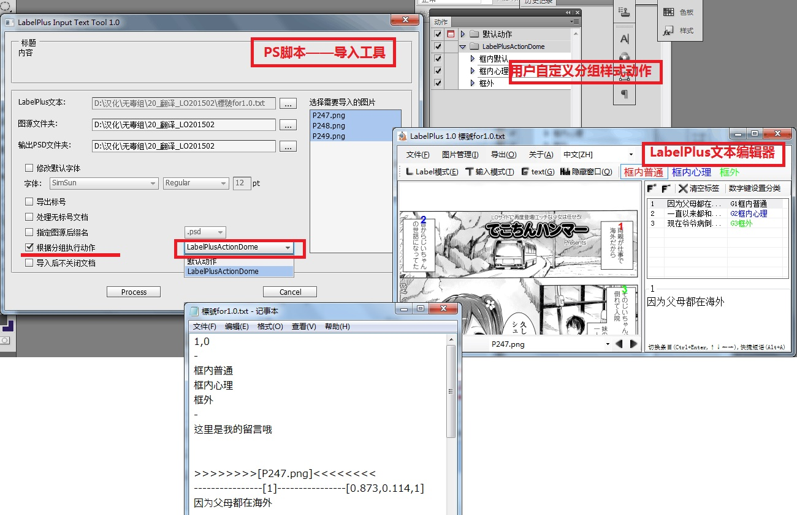

# LabelPlus PS-Script



## 概述

LabelPlus是一个用于图片翻译的工具包，本工程是其中的Photoshop文本导入工具，它读入翻译文本，并将文本逐条添加到PSD档中。

脚本用到的开源项目：
* [xtools(BSD license)](http://ps-scripts.sourceforge.net/xtools.html)中部分工具函数及UI框架
* [JSON Action Manager](http://www.tonton-pixel.com/json-photoshop-scripting/json-action-manager/index.html)中的JSON解析库

功能一览：

* 解析LabelPlus文本 创建对应文本图层
* 允许选择性导入部分文件、分组
* 允许更换图源：可使用不同尺寸、可根据顺序自动匹配文件名（图片顺序、数量必须相同）、可替换图源后缀名
* 自定义自动替换文本规则（如自动将`！？`替换为`!?`）
* 格式设置：字体、字号、行距、文本方向
* 可设置自定义动作：每导入一段文字后，执行动作；打开、关闭文档时执行动作
* 根据标号位置自动涂白（实验功能）

## 开发方法

只需要 Node.js 20 或更高版本，不需要其他工具。下面的命令在 Windows、macOS 和 Linux 上相同，PowerShell、cmd 和 bash 都能用。

### 构建

```
npm ci
npm run build
```

输出在 `build/` 目录：`LabelPlus_Ps_Script.jsx` 是脚本本体，`ps_script_res/` 是文档模板。

在国内下载依赖慢，可以先设置镜像，`package-lock.json` 不需要改：

```
npm config set registry https://registry.npmmirror.com
```

### 发布

版本号只写在 `CHANGELOG.md` 里。`src/version.ts` 是占位值，发布构建时由 `scripts/release.mjs` 填入。

1. 在 `CHANGELOG.md` 里把 `[Unreleased]` 下的条目移到新的版本小节，例如 `## [1.8.2] - 2026-12-01`。`[Unreleased]` 只保留空的小标题。
2. 把这次修改合入 `master`。
3. 在 GitHub 的 Actions 页面选 Release，点 Run workflow，分支选 `master`。

工作流会读取 `CHANGELOG.md` 最上面的版本号，给 `master` 最新提交打上同名 tag，然后构建并发布 Release。以下情况会直接失败：

* `[Unreleased]` 下还有条目，或最新版本小节是空的。
* 同名 tag 已经指向别的提交，或同名 Release 已经存在。

也可以在本地打 tag 并推送，tag 必须和 `CHANGELOG.md` 最新版本一致。

在本地检查版本号，或生成和 CI 相同的发布包 `build/LabelPlus_PS-Script_<版本>.zip`：

```
npm run release -- --print-version
npm run release
```
